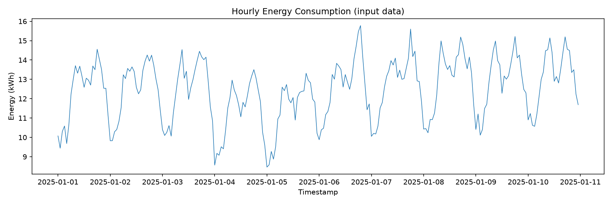
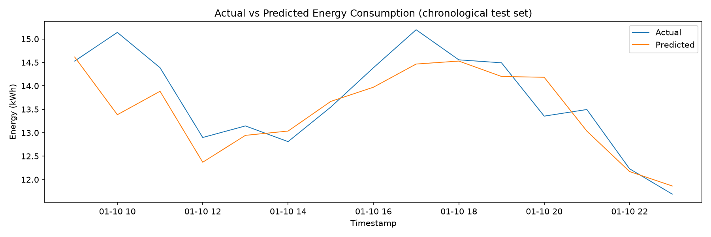
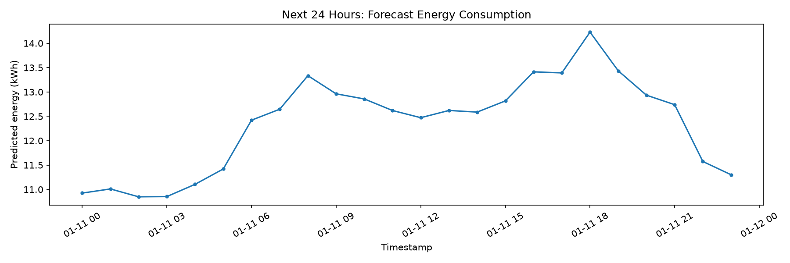
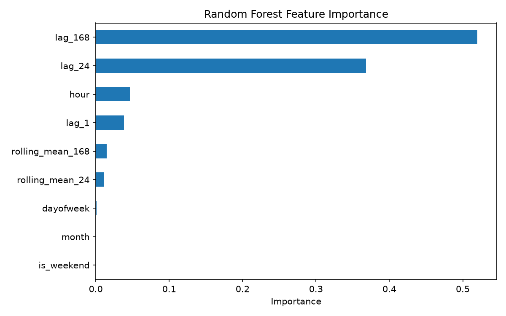
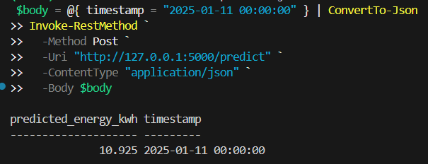

# AI-Powered Energy Consumption Forecasting System

A beginner-friendly, reproducible machine-learning project that forecasts hourly electricity consumption from historical time-series data. It includes a synthetic-data simulation, chronological model evaluation, 24-hour forecasting, saved model artifacts, visualizations, and an optional Flask API.

> **Scope:** This is an educational prototype using simulated energy data by default. It is not connected to a utility, smart meter, or live grid. Forecasting can support planning, but this project does not itself reduce consumption or prevent outages.

## Features

- Generates realistic *synthetic* hourly building-consumption data when no dataset is supplied.
- Accepts a CSV containing `timestamp` and `energy_kwh` columns.
- Cleans and sorts timestamped records and handles missing hourly values.
- Builds time, lag, and rolling-window features without randomly shuffling time-series rows.
- Trains a `RandomForestRegressor` and evaluates it on the most recent portion of the data.
- Reports MAE, RMSE, and R².
- Exports a 24-hour forecast, metrics JSON, model file, and PNG plots.
- Offers an optional Flask `/predict` endpoint.

## Architecture

```text
CSV dataset or synthetic simulator
              |
              v
     Validation and cleaning
              |
              v
 Time + lag + rolling features
              |
              v
 Chronological train/test split
              |
              v
   Random Forest regression
              |
       +------+------+
       |             |
       v             v
 Metrics/plots   Saved model
                     |
                     v
             24-hour forecast
                     |
                     v
              CSV / Flask API
```

## Requirements

- Python 3.10–3.12 recommended
- CPU is sufficient; no GPU required
- Packages are listed in `requirements.txt`

## Setup

### Windows PowerShell

```powershell
py -3.11 -m venv .venv
.\.venv\Scripts\Activate.ps1
python -m pip install --upgrade pip
pip install -r requirements.txt
```

If PowerShell blocks activation, use Command Prompt:
```bat
.venv\Scripts\activate.bat
```

### macOS / Linux

```bash
python3 -m venv .venv
source .venv/bin/activate
python -m pip install --upgrade pip
pip install -r requirements.txt
```

## Run the complete pipeline

From the repository root:

```bash
python main.py
```

By default, the project generates a reproducible synthetic hourly dataset, trains the model, evaluates it, predicts the next 24 hours, and saves results under `outputs/` and `models/`.
At least 8 days of hourly data are required; 10 days is enough for the demo pipeline.

### Use your own dataset

Create a CSV with these columns:

```csv
timestamp,energy_kwh
2026-01-01 00:00:00,12.4
2026-01-01 01:00:00,11.8
2026-01-01 02:00:00,10.9
```

Then run:

```bash
python main.py --data data/energy.csv
```

The timestamp column must parse as a date/time, and energy values must be numeric and non-negative. The sample rows above are illustrative only; provide at least 8 days of hourly observations to run the pipeline.

### Optional: run the API

The API loads the model and training history saved by `main.py`. Start it after training, in the project folder:

```powershell
python app.py
```

Keep that terminal running. Open a second PowerShell window in the project folder and send a POST request:

```powershell
$body = @{ timestamp = "2025-01-11 00:00:00" } | ConvertTo-Json
Invoke-RestMethod `
  -Method Post `
  -Uri "http://127.0.0.1:5000/predict" `
  -ContentType "application/json" `
  -Body $body
```

The timestamp must be exactly one hour after the last timestamp in the dataset used to train the saved model. For the generated 10-day `data/energy.csv`, the last record is `2025-01-10 23:00:00`, so the next timestamp is `2025-01-11 00:00:00`. If you replace the dataset, first rerun `python main.py --data data/energy.csv`, then request the hour after that dataset's final record.

The response contains the requested timestamp and predicted energy in kWh. This endpoint predicts only the next hour; use the command-line pipeline for a 24-hour forecast. The API is a local demonstration service, not a production service. Do not expose Flask's development server publicly.

## Output files

- `outputs/cleaned_energy.csv` — cleaned hourly dataset
- `outputs/test_predictions.csv` — timestamps, actual values, and test predictions
- `outputs/next_24_hours_forecast.csv` — forecast for the next 24 hours
- `outputs/metrics.json` — MAE, RMSE, and R²
- `outputs/energy_history.png` — historical consumption
- `outputs/actual_vs_predicted.png` — held-out test comparison
- `outputs/next_24_hours.png` — future forecast
- `outputs/feature_importance.png` — model feature importance
- `models/energy_forecast_model.joblib` — trained model and feature metadata

Metrics depend on the data and can vary if the dataset changes. Do not claim a specific accuracy until you run the project and record the actual result.

## Sample output visualizations

The charts below are outputs from running `python main.py --data data/energy.csv` with the project's 10-day synthetic test sample (`data/energy.csv`, 2025-01-01 through 2025-01-10). They are generated by the pipeline and will be overwritten with new charts when you rerun it with a different dataset.

### Input energy history



### Actual versus predicted test values



### Forecast for the next 24 hours



### Model feature importance



### API prediction response

The screenshot below shows the successful `/predict` API response for the next hour after the 10-day sample `data/energy.csv` (2025-01-11 00:00:00).



## Evaluation

- **MAE:** average absolute prediction error, in kWh.
- **RMSE:** square-root of average squared error, in kWh; it penalizes large errors more heavily.
- **R²:** comparison with a simple mean baseline; it can be negative when predictions perform poorly.

A time-ordered holdout is used because randomly shuffling timestamps can leak future patterns into training. The synthetic dataset is useful for software testing and learning, but strong results on synthetic data do not prove performance on a real building.

## Repository structure

```text
AI-Energy-Forecasting/
├── data/                 # Optional input CSV
├── notebooks/            # Exploration notebooks
├── src/
│   ├── __init__.py
│   └── forecasting.py    # Data, features, model, evaluation, plots
├── models/                # Saved model artifact (generated)
├── outputs/               # CSV, metrics and PNGs (generated)
├── images/                # Selected screenshots for README
├── screenshots/           # Captured API and project output screenshots
├── docs/                  # Design notes and limitations
├── app.py                 # Optional Flask API
├── main.py                # CLI entry point
├── requirements.txt
├── .gitignore
└── README.md
```

## Industry relevance

Energy forecasts can help facility teams plan operating schedules, identify expected peak periods, and compare expected demand with measured demand. A production implementation would need representative meter data, weather and occupancy inputs where appropriate, monitoring for data drift, security, and validation with domain experts.

## Limitations and next steps

1. Replace synthetic data with a documented real dataset.
2. Compare the Random Forest with a seasonal-naive baseline.
3. Add weather, occupancy, calendar, or tariff features if available.
4. Track performance over multiple time-based test windows.
5. Add model/version metadata, input validation, tests, and deployment monitoring.
6. Never use this demo as the sole basis for grid operation or safety-critical decisions.
